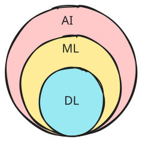

在 AI 出現的幾年之內，大家的生活似乎已經離不開 AI，平常會使用到的手機臉部解鎖、影音平台精準推送你感興趣的內容、或是 Tesla 一直在開發的自動駕駛，這些都要歸功於 AI。
雖然如此大量地使用著 AI，但對於 AI 卻好像沒有一個較為基礎、全面的認識。後面會從 AI 到底是什麼，怎麼運作的，有哪些分支，一路探索到 LLM、RAG、AI Agent 等等，也許在使用 Codex, Claude, Gemini 等 AI Chatbot 的時候能有不一樣的見解和想法。

## 什麼是 AI？

Artificial Intelligence (AI) 是一系列技術的總稱，他賦予了電腦能夠學習、推理、執行高階任務的能力，Artificial 在英文裡是人工、人造的意思，所以人工智慧就是讓電腦模擬人類大腦，去做那些過去需要人才能做的事，像是語言學習、資料分析、圖像辨識，近期由於 AI 的能力越發強大，大家都會因此戲稱為「大腦外包」。

## AI 是如何運作的？

AI 的技術雖然有許多不同的種類，但所有的基礎都是由數據 ( Data )、演算法 ( Algorithms )、還有算力 ( Computational power ) 所構成，AI 透過大量的數據來學習和改進當前系統，這些數據就是所謂的訓練材料，其品質與數量對於 AI 的性能至關重要。
就像前面提到的，AI 是一個涵蓋多個關鍵領域的廣泛總稱：

- **機器學習 ( Machine Learning, ML )**：讓系統可以透過大量的資料來學習、識別模式，並且進行預測或是決策。例如透過向電腦展示成千上萬張狗狗的圖片，他就能自主學習和辨識狗狗所應該具備的外型特徵。
- **深度學習 ( Deep Learning, DL )**：屬於機器學習 ( ML ) 的一個子領域，深度學習使用了很多層的人工神經網路對資料進行學習 ( 所以才叫做「深度」)，這些網路的設計靈感來自於人腦的結構，擅長處理複雜的任務像是圖像或是語音辨識。
- **自然語言處理 ( Natural Language Processing, NLP )**：NLP 讓電腦可以理解、翻譯並生成人類的語言，這就是 Siri、Alexa 等語音助手，還有翻譯服務、聊天機器人的原動力。
- **電腦視覺 ( Computer Vision)：** 這個領域讓電腦可以「看到」並且解讀視覺化的訊息，像是圖像或是影片，用於臉部辨識、自動駕駛等。

### AI、ML、和DL的差異是什麼？

可以把 AI、ML、DL 想成層層包裹的關係，ML 是 AI 的一個子領域，DL 又是 ML 的一個子領域。

AI 最大的目標在於：

> 讓電腦表現出原本需要「智慧」才能完成的行為

也就是說，AI 不一定需要學習。所以 AI ≠ ML，ML 只是實現 AI 的一種方法。

而 ML 和 DL 的差異在於，傳統的 ML 更多的需要人為的干預、介入機器訓練與學習的過程，透過研究員餵養結構化、經標記的訓練資料，讓機器能夠精準的進行分類和結果預測。DL 利用多層的神經網路（neural network），讓機器可以在不須人為干預的情況下自主管理學習，處理更多更大的資料。
例如今天我們想要讓機器辨識一隻狗，工程師需要先決定需要輸入那些經過標籤的東西給機器，耳朵、尾巴、腳掌，機器學習之後就能分辨什麼是狗，也就是

> 人幫模型決定什麼重要

而 DL 則可以做到讓機器自動學習不同的特徵，直接處理原始的、非結構化的數據。

## AI 的種類

根據 AI 的智慧水平以及問題解決能力，可以分為以下幾個類型：

- **Artificial Narrow Intelligence (ANI)**：目前所有的 AI 都屬於 ANI 的範疇，主要用於處理特定、單一的任務，像是影像辨識、郵件分類，或者是 LLM、生成式 AI 等等，ANI 不具備推理能力或是自我意識，所以基本上輸入的訓練材料決定了他的預測輸出結果。
- **Artificial General Intelligence (AGI)**：目前還沒有 AGI 的出現，屬於未來科技發展的方向，理論上 AGI 可以執行更為廣泛的任務，利用類似人類的推理能力進行學習、適應與改進，但也因此 AGI 可能會造成重大的安全和倫理問題。
- **Artificial Superintelligence (ASI)**：超級人工智慧，擁有自我意識並且不受人類控制的個體，推理、創造力甚至情商都遠超人類的智慧，可能會極大程度的對人類的生存產生威脅。

下一篇會接著討論近年來快速發展並且為人們所熟知的生成式人工智慧（generative AI）、LLM 以及 AI Agents。

## References

https://datasaur.ai/blog-posts/differences-between-ai-ml-and-dl
https://cloud.google.com/learn/what-is-artificial-intelligence
https://cloud.google.com/learn/what-is-machine-learning
