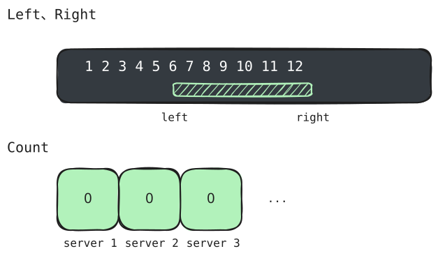

## 題目連結

[LeetCode 2747. Count Zero Request Servers](https://leetcode.com/problems/count-zero-request-servers/)

## 題目敘述

題目總共會給定 4 個變數：`n、logs、x、queries`

- `n`：是一個正整數，表示總共有幾台機器。
- `logs`：是一個 array，資料型態會是 `logs[i] = [server_id, time]`，意思是每一台機器分別會在什麼時間收到指令。例如 `logs = [[1,3],[2,6],[1,5]]` 就表示第一台機器會在第 3、5秒的時候收到指令，第二台會在第 6 秒，第三台則從來沒有。
- `x`：是一個正整數，表示時間間隔範圍。
- `queries`：是一個 array，表示不同的時間，例如 `queries = [10,11]` 表示 10 秒和 11 秒。

我們需要找到在特定的時間範圍內，有多少台機器完全沒有被呼叫到，並且依照 `queries` 的順序回傳一組 array。

例如 `n = 3, logs = [[1,3],[2,6],[1,5]], x = 5, queries = [10,11]`，表示機器總共有三台，時間間隔是 5，要檢查的時間分別是 10、11，也就是說在 5-10 秒和 6-11 秒分別有幾台機器沒有被呼叫，5-10 秒只有一台沒有被呼叫 (3)，6-11 秒則有兩台沒有被呼叫 (1、3)，所以我們要返回的答案就是 `[1,2]`。

**Constraints:**

- `1 <= n <= 10^5`
- `1 <= logs.length <= 10^5`
- `1 <= queries.length <= 10^5`
- `logs[i].length == 2`
- `1 <= logs[i][0] <= n`
- `1 <= logs[i][1] <= 10^6`
- `1 <= x <= 105`
- `x < queries[i] <= 10^6`

## 解法一：暴力解

最直觀的做法就是拿 `queries` 的秒數減去 `x` 之後 loop through 每一個 log 去檢查他有沒有在該區間內，程式碼大概會像這樣

```js
const result = []
queries.forEach((query) => {
  const activeServers = new Set()
  const min = query - x
  for (let i = 0; i < logs.length; i++) {
    if (logs[i][1] >= min && logs[i][1] <= query) {
      activeServers.add(logs[i][0])
    }
  }
  result.push(n - activeServers.size)
})

return result
```

這個做法的好處是簡單易懂，而且每次的檢查都比較像是獨立事件，我們不需要去將 `logs` 或是 `queries` 做排序，但缺點也顯而易見，太慢了。設 `m = logs.length`、`q = queries.length`，每個 query 都需要遍歷所有的 log，時間複雜度是 `O(mq)`，在長度較長的 test case 就會 TLE。每次查詢的 `Set` 最多記錄 `min(n, m)` 台機器，因此輔助空間是 `O(min(n, m))`；若包含回傳的陣列，空間複雜度則是 `O(min(n, m) + q)`。

## 解法二：Sliding Window + Offline Queries

由於時間的間隔是固定的，所以每一段時間的長度也是固定的，我們就可以建立一個向右移動的 Sliding Window，在移動的過程中新增進入視窗中的機器編號，並移除已經不在視窗中的機器編號，這就是 Sliding Window 很重要的觀念：**只處理窗口的變動，而不是每次都重新計算。**

Sliding Window 的特性是，他會從一個方向往另外一個方向移動，不論窗口的大小是否改變，也因此我們的資料在型態上必須具備連續性，所以我們可以先將題目給定的機器呼叫時間 `logs` 以及希望我們檢查的時間 `queries` 做排序

```js
// logs = [[1,3],[2,6],[1,5]]
logs.sort((a, b) => a[1] - b[1])
// [[1,3], [1,5], [2,6]]

// queries = [10,11]
const sortedQueries = queries
  .map((time, index) => ({ time, index }))
  .sort((a, b) => a.time - b.time)
// [{time: 10, index: 0}, {time: 11, index: 1}]
```

> [!note]
> 這裡有一個要注意的點是，由於答案要求我們返回的 array 必須跟 `queries` 的順序是一樣的，所以我們在排序的過程中也必須記下原本各個時間的 `index`

接下來，我們需要來建立我們的窗口，以及用來紀錄機器被呼叫次數的容器 (由於同一台機器可能會在一個時間段內被呼叫很多次，所以我們不能單純只用「有」或「沒有」被呼叫來記錄)，所以我們會需要宣告以下幾個變數：

- `left`：窗口的左邊界，要開始檢查的時間點
- `right`：窗口的右邊界，結束檢查的時間點
- `count`：每台機器被呼叫的次數
- `activeServers`：總共有幾台機器被呼叫



宣告完我們需要的變數之後，接下來就是依序去針對題目所給定的時間 `queries` 做檢查，而每次檢查要做的事情只有三個：

- 移動右窗口，並把其中經過的 `logs` 都加入，直到時間區間的尾端
- 移動左窗口，並把掉出窗口外的 `logs` 移除，直到時間區間的起點
- 上面兩個部分都處理完之後，把沒有收到請求的機器數量 `n - activeServers` 存到 result array 相對應的 index 上 (根據我們前面在排序 `queries` 時候的 index)

> [!important]
> 這裡有另外一個要注意的地方，雖然 `left` 跟`right` 指的確實是時間上的邊界，可是他不直接等於時間，意思是如果今天時間區間是 5-10 秒，`left` 跟 `right` 也不一定直接等於 5 跟 10。
> 假設 `logs = [[1,3], [1,5], [2,6], [3,6], [2,10], [1,11]]`，處理完 5-10 秒的查詢後，`left` 會在 `[1,5]` 的位置，也就是 index 1，而 `right` 會停在第一筆尚未加入的 `[1,11]`，也就是 index 5。視窗內的紀錄是 `logs[left]` 到 `logs[right - 1]`，所以這兩個指標代表的是陣列索引，而不是秒數；如果所有紀錄都已加入，`right` 也可能等於 `logs.length`。

## JavaScript 實作

```javascript
/**
 * @param {number} n
 * @param {number[][]} logs
 * @param {number} x
 * @param {number[]} queries
 * @return {number[]}
 */
var countServers = function (n, logs, x, queries) {
  logs.sort((a, b) => a[1] - b[1])
  const sq = queries.map((time, index) => ({ time, index })).sort((a, b) => a.time - b.time)

  let left = 0,
    right = 0
  const count = new Int32Array(n + 1)
  let activeServers = 0
  const result = []

  for (const { time, index } of sq) {
    const start = time - x
    while (right < logs.length && logs[right][1] <= time) {
      const id = logs[right][0]
      if (count[id] === 0) {
        activeServers++
      }

      count[id]++
      right++
    }

    while (left < right && logs[left][1] < start) {
      const id = logs[left][0]

      count[id]--
      if (count[id] === 0) {
        activeServers--
      }

      left++
    }

    result[index] = n - activeServers
  }
  return result
}
```

## 複雜度

設 `m = logs.length`、`q = queries.length`，`n` 為伺服器總數。

- **時間：** `O(n + m log m + q log q)`。排序 `logs` 與查詢分別需要 `O(m log m)`、`O(q log q)`；初始化 `count` 需要 `O(n)`。排序後，`left` 與 `right` 各自最多走過 `m` 筆紀錄，所有查詢合計只需 `O(m + q)`，並不會因為每次查詢內有兩個 `while` 就變成 `O(mq)`。
- **空間：** `O(n + q)`，不含 JavaScript 內建排序使用的額外空間。`count` 需要 `O(n)`，保留原始索引的查詢陣列 `sq` 與回傳陣列 `result` 各需要 `O(q)`，其餘變數都是 `O(1)`。內建 `sort()` 的額外空間依 JavaScript 引擎實作而異，不能只因為它會原地修改陣列就視為 `O(1)`。
