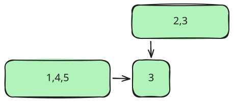
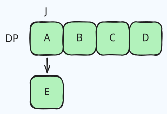
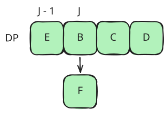

## 題目連結

[LeetCode 3882. Minimum XOR Path in a Grid](https://leetcode.com/problems/minimum-xor-path-in-a-grid/)

## 題目敘述

給定一個大小為 `(m * n)` 的 `grid`，從最左上角的 `(0,0)` 一直走到右下角的 `(m-1, n-1)`。期間你可以往右或是往下移動，每次移動的花費就是該路徑上所有格子的 bitwise XOR，包含起點跟終點。例如你從 `1` 移動到 `3`，那麼需要的花費就是 `1 XOR 3`，也就是 `2`。試圖找出從左上角移動到右下角花費最少的路徑。

> **Example 1:**
> **Input:** grid = `[[1,2],[3,4]]`
> **Output:** 6
> **Explanation:**
> There are two valid paths:
>
> - `(0, 0) → (0, 1) → (1, 1)` with XOR: `1 XOR 2 XOR 4 = 7`
> - `(0, 0) → (1, 0) → (1, 1)` with XOR: `1 XOR 3 XOR 4 = 6`

The minimum XOR value among all valid paths is 6.

> **Example 2:**
> **Input:** grid = `[[6,7],[5,8]]`
> **Output:** 9
> **Explanation:**
> There are two valid paths:
>
> - `(0, 0) → (0, 1) → (1, 1)` with XOR: `6 XOR 7 XOR 8 = 9`
> - `(0, 0) → (1, 0) → (1, 1)` with XOR: `6 XOR 5 XOR 8 = 11`

The minimum XOR value among all valid paths is 9.

> **Example 3:**
> **Input:** grid = `[[2,7,5]]`
> **Output:** 0
> **Explanation:**
> There is only one valid path:
>
> - `(0, 0) → (0, 1) → (0, 2)` with XOR: `2 XOR 7 XOR 5 = 0`

The XOR value of this path is 0, which is the minimum possible.

**Constraints:**

- `1 <= m == grid.length <= 1000`
- `1 <= n == grid[i].length <= 1000`
- `m * n <= 1000`
- `0 <= grid[i][j] <= 1023​`

## 解題思路

Minimum XOR 與傳統的 Minimum max 不同，我們不能只記錄每一個位置的 Minimum number，因為 XOR 的特性與加法不同，加法具有大小關係

```text
a < b => a + c < b + c
```

這件事情是確定的，但是以 XOR 來說

```
2 < 3
2 ^ 3 = 1
3 ^ 3 = 0
```

因此目前較小的 XOR，不能代表他往後走一定是最小，也就是說他不具有 **monotonicity** 的特性，所以我們需要紀錄每個位置的前一步可能出現的所有 XOR，以此推進到終點。

## DP 紀錄所有 XOR

我們可以創建一個 3 維的 DP State，來存放當前位置所有可能的 XOR 結果，但這裏我們應該要用什麼資料型態來儲存？第一直覺可能是 `Set()`，因為他所具備的去重複特性，可以幫助我們快速排除相同結果的 XOR，但題目裡其實藏了一個條件：

```
0 <= grid[i][j] <= 1023​

1023 = 2^10 -1
```

所以所有的數字轉換成 bit 最多只會有 10 位，因此不論中間 XOR 多少次，最後的結果都一定是

```
0 <= XOR <= 1023
```

所以最多只有 1024 種 XOR 的可能，因此我們可以改用長度為 1024 的 `Uint8Array()` 來作為我們的狀態表。

### Uint8Array v.s. Set

`Uint8Array` 和 `Set` 的差別最主要在於他們一個是 **Dense State** 一個是 **Sparse State**。

> - Dense State -> Array、TypedArray
> - Sparse State -> Set、Map

Dense 指的就是對於一份資料表來說，我們紀錄了所有的資訊，包含 0 的部分

```
0 1 0 3 5 0
0 2 0 0 6 0
0 0 4 0 0 0
```

Sparse 則只記錄所有**非0**的部分

```
  1   3 5
  2     6
    4
```

那你可能會想，這樣 Sparse State 儲存的資料比較少，後續的比對不是比較輕鬆跟快速嗎？對，以資料長度來說 `Set` 肯定會比 `Uint8Array` 來的少，但是我們還需要考慮到當我們需要做查詢、新增、刪除，或者是當我們新增一個 value 之後 `Set` 本身需要去重複的過程，都比我們直接透過 index 去對 `Uint8Array` 做處理來的耗時，在這種有限定範圍且範圍不大的 DP 題目其實 `Uint8Array` 是很好用的。

### Uint8Array 紀錄

回到紀錄 XOR 的部分，我們已經決定使用 `Uint8Array` 了，接下來就是遍歷每一個格子，取得他們所有可能的 XOR。
首先先建立一個 3維 dp，每個格子都是一個長度為 1024 的 `Uint8Array`

```js
const m = grid.length
const n = grid[0].length

const dp = Array.from({ length: m }, () => Array.from({ length: n }, () => new Uint8Array(1024)))
dp[0][0][grid[0][0]] = 1
```

接下來我們要遍歷格子並更新他們的 XOR value，由於題目規定只能往右和往下走，所以對於某個特定格子來說，他所有可能的 XOR value 來源只有「上面」以及「左側」



因此我們只要拿上面以及左側的所有值依序跟當前 value 做 XOR，並把 `Uint8Array` 的該 index 標記為 reachable，也就是 `1` 即可：

```js
for (let i = 0; i < m; i++) {
  for (let j = 0; j < n; j++) {
    if (i === 0 && j === 0) continue

    const value = grid[i][j]

    for (let xor = 0; xor < 1024; xor++) {
      const fromTop = i > 0 && dp[i - 1][j][xor]

      const fromLeft = j > 0 && dp[i][j - 1][xor]

      if (fromTop || fromLeft) {
        dp[i][j][xor ^ value] = 1
      }
    }
  }
}
```

當我們記錄完所有 XOR value 之後，只要從終點那一格找最小的值 return 即可

```js
for (let xor = 0; xor < 1024; xor++) {
  if (dp[m - 1][n - 1][xor]) {
    return xor
  }
}

return -1
```

## 進階與優化：Rolling DP

我們可以再針對以上的解法做優化，其實我們並不需要透過一個3維的 dp 紀錄所有格子的資訊，因為大部份的資訊我們到後面根本用不到，所以我們可以只創建一個 2 維的 dp 並滾動式更新，來達到我們原本的目的。
假設有一個 matrix 是

```
A B C D
E F G H
```

跑完第一次之後我們的 dp 會是 `[A,B,C,D]`，接下來要處理 `E`

我們要找的其實是

```js
dp[j]
```

也就是他的上面，處理完之後會變成 `[E,B,C,D]`。
接下來處理 `F`，同樣我們需要處理上面與左側

這時你會發現，對於 `F` 來說，上面跟左側其實就是 `E` 跟 `B`，所以我們要找的其實是

```js
dp[j - 1]
dp[j]
```

因此我們可以寫出另一套解法，只保留一列的 2 維 dp，並且用一個 `next` 去保留計算完的結果，在每一格全部計算完畢之後更新 dp：

```js
const dp = Array.from({ length: n }, () => new Uint8Array(1024))
const next = new Uint8Array(1024)
dp[0][grid[0][0]] = 1

for (let i = 0; i < m; i++) {
  for (let j = 0; j < n; j++) {
    if (i === 0 && j === 0) continue

    const value = grid[i][j]
    next.fill(0)

    for (let xor = 0; xor < 1024; xor++) {
      if (dp[j][xor] || (j > 0 && dp[j - 1][xor])) {
        next[xor ^ value] = 1
      }
    }
    dp[j].set(next)
  }
}
```

這裡有一個要注意的點是，因為我們的 next 是宣告在外面，所以我們在迴圈中不能寫

```js
dp[j] = next
```

這樣他們會指向同一個 reference，在下一輪會被清掉，目前的寫法是將 `next` 中的內容複製到 `dp` 裡面，做的是 Buffer reuse，不要一直 allocation 新的 buffer

```js
dp[j].set(next)
```

## JavaScript 實作

```javascript
/**
 * @param {number[][]} grid
 * @return {number}
 */
var minCost = function (grid) {
  const m = grid.length
  const n = grid[0].length

  const dp = Array.from({ length: n }, () => new Uint8Array(1024))
  const next = new Uint8Array(1024)
  dp[0][grid[0][0]] = 1

  for (let i = 0; i < m; i++) {
    for (let j = 0; j < n; j++) {
      if (i === 0 && j === 0) continue

      const value = grid[i][j]
      next.fill(0)

      for (let xor = 0; xor < 1024; xor++) {
        if (dp[j][xor] || (j > 0 && dp[j - 1][xor])) {
          next[xor ^ value] = 1
        }
      }
      dp[j].set(next)
    }
  }

  return dp[n - 1].indexOf(1)
}
```

## 複雜度

- **時間：** `O(mnK), K=1024`
- **空間：** `O(nK + K), K=1024`
