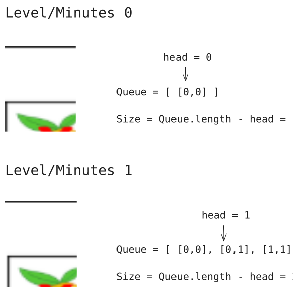

## 題目連結

[LeetCode 994. Rotting Oranges](https://leetcode.com/problems/rotting-oranges/)

## 題目敘述

題目會給定一個 `m*n` 的 matrix，其中會包含 `0、1、2` 的數字，他們分別代表的意義是：
- `0`：空的格子
- `1`：健康的橘子
- `2`：腐爛的橘子

腐爛的橘子每分鐘會向它的上下左右擴散，跟他相連接的健康橘子會被汙染成腐爛的橘子，需要計算出在第幾分鐘的時候所有的橘子都變成腐爛的，如果有橘子始終都保持健康狀態的話就返回 `-1`。
> [!note]
> 需要注意在最一開始的時候不一定只有一個腐爛的橘子。

**Example 1:**


**Input:** grid = `[[2,1,1],[1,1,0],[0,1,1]]`
**Output:** 4

**Example 2:**

**Input:** grid = `[[2,1,1],[0,1,1],[1,0,1]]`
**Output:** -1
**Explanation:** The orange in the bottom left corner (row 2, column 0) is never rotten, because rotting only happens 4-directionally.

**Example 3:**

**Input:** grid = `[[0,2]]`
**Output:** 0
**Explanation:** Since there are already no fresh oranges at minute 0, the answer is just 0.

**Constraints:**

- `m == grid.length`
- `n == grid[i].length`
- `1 <= m, n <= 10`
- `grid[i][j]` is `0`, `1`, or `2`.

## 解題思路

我們可以透過 BFS 的方式，每一次都針對所有已經腐爛的橘子去做擴散，直到沒有新的腐爛的橘子為止。
### 初始紀錄

由於我們沒辦法保證一開始只有一個腐爛的橘子，所以我們勢必要先把所有的格子都先跑過一遍，並且把初始腐爛的橘子加到我們的 `queue` 中，同時記錄新鮮橘子的數量，方便我們最後確認有沒有橘子一直都保持新鮮
```javascript
const queue = []
let fresh = 0;
let minutes = 0;

for(let i = 0; i<grid.length; i++){
	for(let j = 0; j<grid[0].length; j++){
		if(grid[i][j] === 2){
			queue.push([i, j])
		}else if(grid[i][j] === 1){
			fresh++
		}
	}
}
```

### BFS 實作

接下來就要進入到 BFS 的環節。

BFS 有兩個很重要的概念是 `Level` 與 `Distance`，每一次的執行都會把當前的 `Level` 處理完才會進入到下一個 `Level`，並且增加 `Distance`，在這一題可以把 `Level` 想成是「當下所有未處理的腐爛橘子」，而 `Distance` 則是「總共經過的時間」。

如果用 JavaScript 的 `Array.prototype.shift()` 取出隊首，搬移剩餘元素最壞需要 `O(k)` 時間，其中 `k` 是陣列當下的長度。這裡用 `head` 記錄下一筆要處理的位置，每次以 `O(1)` 時間讀取 `queue[head++]`。



```javascript
    const directions = [ [-1, 0], [1, 0], [0, -1], [0, 1] ]
    let head = 0;

    while(head < queue.length && fresh > 0){
	    //新的腐爛橘子的數量
        const size = queue.length - head

		// 往上下左右擴散
        for(let i = 0; i<size; i++){
            const [r, c] = queue[head++]

            for(const [dr, dc] of directions){
                const nr = r + dr
                const nc = c + dc

                if(
                    nr < 0 ||
                    nr >= grid.length ||
                    nc < 0 ||
                    nc >= grid[0].length ||
                    grid[nr][nc] !== 1
                ) continue

                grid[nr][nc] = 2
                queue.push([nr, nc])
                fresh--
            }
        }

        minutes++
    }
```

最後我們只要確認新鮮的橘子數量是否為 0，如果是就返回 `minutes`，不是就返回 `-1`。

## JavaScript 實作

```javascript
/**
 * @param {number[][]} grid
 * @return {number}
 */
var orangesRotting = function (grid) {
    const queue = []
    let fresh = 0;
    let minutes = 0;
    for (let i = 0; i < grid.length; i++) {
        for (let j = 0; j < grid[0].length; j++) {
            if (grid[i][j] === 1) {
                fresh++
            } else if (grid[i][j] === 2) {
                queue.push([i, j])
            }
        }
    }

    const directions = [
        [-1, 0],
        [1, 0],
        [0, -1],
        [0, 1]
    ]
    let head = 0
    while (head < queue.length && fresh > 0) {
        const size = queue.length - head

        for (let i = 0; i < size; i++) {
            const [r, c] = queue[head++]

            for (const [dr, dc] of directions) {
                const nr = r + dr
                const nc = c + dc

                if (
                    nr < 0 ||
                    nr >= grid.length ||
                    nc < 0 ||
                    nc >= grid[0].length ||
                    grid[nr][nc] !== 1
                ) continue

                grid[nr][nc] = 2
                queue.push([nr, nc])
                fresh--
            }
        }

        minutes++
    }
    return fresh === 0 ? minutes : -1
};
```

## 複雜度

設 `m`、`n` 分別為 `grid` 的列數與欄數。

- **時間複雜度為 `O(m * n)`。** 初始化會掃描整張網格。BFS 在新鮮橘子入隊前就把它標為腐爛，因此每個格子最多入隊一次，每次處理只需檢查四個方向。
- **額外空間複雜度為 `O(m * n)`。** 腐爛狀態直接更新在 `grid` 裡。`head` 只往前移動，已處理的座標仍留在 `queue`，最壞會保留 `m * n` 筆座標。
