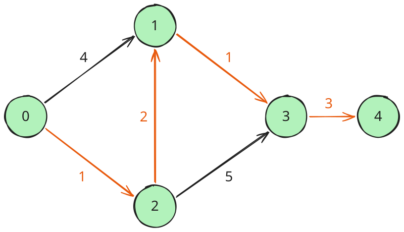
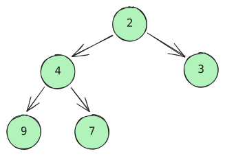
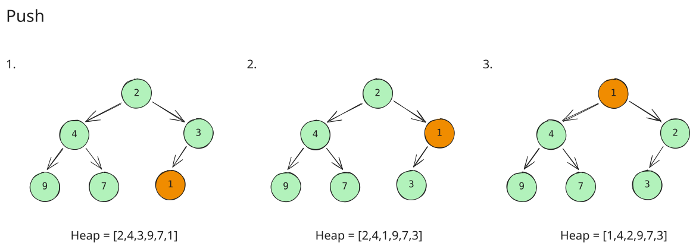
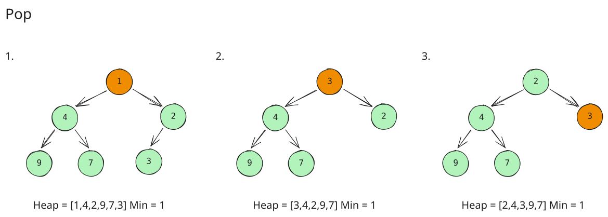

Dijkstra 演算法通常被認為是最直觀的最短路徑演算法，主要用來解決 Single-source shortest path 的問題，single-source 是指你可以選擇一個起點，演算法會幫你找出該起點到任一終點的最短路徑。

Dijkstra 主要的應用領域：

- GPS導航與路線規劃
- 電腦網路與路由協定
- 遊戲開發
- 分散式系統

假設你有一張由節點 (Vertex) 和邊 (Edge) 所組成的圖，每一條邊都有自己的權重 (Weight)，權重可以代表距離、行駛時間、路由成本、傳輸延遲等等，給定起點 `0`，我們希望找到從 `0` 到所有節點的**最小總權重**。

> [!important]
> 必須注意的是，權重的值必須是一個非負的數，Dijkstra 演算法無法處理帶有負權重的邊



以上面這張圖來說，從 `0` 走到 `4` 的最短路徑就是 `7`。這裡還有一個比較重要的觀念是

> **Dijkstra 並不是每次選擇權重最小的邊，而是選擇目前「從起點出發，累積距離最短」的節點。**

接下來會說明我們該怎麼去實作 Dijkstra。

## Dijkstra 的核心原理

Dijkstra 主要使用的是 Greedy Algorithm (貪婪演算法)，並搭配一個稱為 Relaxation (鬆弛) 的操作。
首先我們宣告一組陣列，用來存放各個節點的「當前最短距離」，起點是 `0`，剩下的還沒找到所以設為 `Infinity`

```js
const dist = Array(n).fill(Infinity)
dist[start] = 0
```

接下來，根據上面那張圖，節點 `0` 可以走到 `1` 和 `2`，所以第一次的更新結果應該會是

```js
dist[0] = 0
dist[1] = 4
dist[2] = 1
```

接下來我們選擇 `2` 繼續走，發現如果從 `0 -> 2 -> 1` 的權重只需要 `3`，比原本的值小，所以我們就更新 `dist[1] = 3`，這個做法就是前面提到的 **Relaxation (鬆弛)**。

```js
// Relaxation
const newDist = dist[u] + weight

if (newDist < dist[v]) {
  dist[v] = newDist
}
```

這就是 Dijkstra 最重要的一個概念。接下來就延續前面的動作繼續尋找最短的節點一直到我們的目標為止。

做到這邊你會發現，我們需要一個東西幫助我們在前進的過程中，快速找到當前最短路徑的節點，而這個東西就叫做 **Priority Queue**。

## Priority Queue

Priority Queue 是一種資料結構，他的特色是每次取出元素的時候，會取出**優先集最高的元素，而不是最早加入的**，Priority Queue 有兩種常見的形式：

- **Min Priority Queue**：每次取出最小值
- **Max Priority Queue**：每次取出最大值

Dijkstra 使用的是 **Min Priority Queue**，因為我們要找的是最短路徑。

由於 JavaScript 沒有原生的 Priority Queue 可以使用，所以我們需要自己寫一個，下面會說明我們該如何使用 JavaScript 去實作一個 Min Priority Queue

## 實作 Min Priority Queue

為了能快速找到目前 cost 最小的 node，我們需要製作一個 Min Priority Queue，這個 Min Priority Queue 是一個特殊的 array，他最主要的概念有兩個：

- 最小的元素永遠在第一位
- 父節點永遠不比子節點大

所以你可以把 Min Priority Queue 想成**一棵「父節點永遠不比子節點大」的完全二元樹。**
例如我們現在有一個數列 `[2, 4, 3, 9, 7]`，可以排成下面這樣：



> [!note]
> Binary Min Heap 不一定會完全排序，但是他符合所有 parent node <= child node，所以根元素 `2` 一定會是整個 Heap 中最小的元素

可以看到他同時滿足所有的 parent <= child 而且最小的元素在最上面，這就是一個合格的 Min Priority Queue。

由於 JavaScript 不像某些語言有原生的 `PriorityQueue`，所以我們必須要自己宣告一個，要製作 Min Priority Queue 需要有兩個比較重要的功能：

- `push()`：當我們有一個新的元素加入的時候，在 Min Heap 裡面需要讓最小的元素保持在最上方。
- `pop()`：當我們拿掉最小的元素後，要重新讓剩下的元素中最小的移動到最上方，且剩餘元素也要符合上面兩項條件。

### 初始化 Min Priority Queue

我們透過 class 搭配一個 Comparator Function，讓我們創建的 Priority Queue 能夠更加通用

```js
class PriorityQueue {
  constructor(compare = (a, b) => a - b) {
    this.heap = []
    this.compare = compare
  }

  isEmpty() {
    return this.heap.length === 0
  }
}
```

初始化完成之後，就可以來處理兩個最重要的功能。

### push() — Bubble Up

假設現在的 `heap = [2,4,3,9,7]`，我們想要加入 `1`，我們可以透過 bubble up 的方式來把它放到正確的位置：

- 先放到 heap 的尾端
- 比較新節點與他的 Parent node
- 如果新節點較小，就向上交換
- 不斷重複，直到新節點大於 Parent node



每次只會沿著樹向上移動，最多走過樹的高度，Binary Tree 的高度是

```js
h = O(log n)
```

所以 `push` 的時間複雜度也是 `O(log n)`

```js
push(value) {
	const heap = this.heap
	heap.push(value)

	let i = heap.length - 1

	while(i > 0){
		const parent = Math.floor((i-1) / 2)

		if(this.compare(heap[i], heap[parent]) >= 0){
			break
		}

		[heap[i], heap[parent]] = [heap[parent], heap[i]]
		i = parent
	}
}
```

> [!note]
> 在 Binary Heap 中有幾個比較重要的公式，假設當前元素的 index 是 `i`
>
> - **Parent**：`Math.floor((i-1) / 2)`
> - **Left Child**：`i * 2 + 1`
> - **Right Child**：`i * 2 + 2`

### pop()：Bubble Down

現在 `heap = [1,4,2,9,7,3]`，我們想要把 `1` 取出來，可以透過 Bubble Down 的方式整理剩下的元素：

- 先把 `1` 紀錄為 `min`，方便後續做 return
- 用最後一個元素取代 `heap[0]`，並且移除該元素
- 比較兩邊的 Child Node，跟較小的一邊做交換
- 重複向下比較，直到兩個 Child Node 都大於該節點



```js
pop() {
	const heap = this.heap

	if(heap.length === 0) return undefined

	const min = heap[0]
	const last = heap.pop()

	if(heap.length === 0) return min

	heap[0] = last

	let i = 0

	while(true){
		const left = i * 2 +1
		const right = i * 2 +2
		let smallest = i

		// 決定左邊還是右邊比較小
		if(
			left < heap.length &&
			this.compare(heap[left], heap[smallest]) < 0
		){
			smallest = left
		}

		if(
			right < heap.length &&
			this.compare(heap[right], heap[smallest]) < 0
		){
			smallest = right
		}

		// 都沒有比較小就停止
		if(smallest === i) break

		// 跟比較小的交換，並且把 index 移動到交換後的位置
		[heap[i], heap[smallest]] = [heap[smallest], heap[i]]

		i = smallest
	}

	return min
}
```

## 完整 Dijkstra 實作

我們回到 Dijkstra 的部分，將我們剛剛創建的 Priority Queue 結合起來

```js
function Dijkstra(graph, start) {
  const n = graph.length

  const dist = new Array(n).fill(Infinity)

  // [node, weight]
  const pq = new PriorityQueue((a, b) => a[1] - b[1])

  dist[start] = 0
  pq.push([start, 0])

  while (!pq.isEmpty()) {
    // 當前最短路徑
    const [node, currentDist] = pq.pop()

    // 篩選掉過期的紀錄
    if (currentDist > dist[node]) continue

    for (const [v, weight] of graph[node]) {
      const newDist = currentDist + weight

      // Relaxation
      if (newDist < dist[v]) {
        dist[v] = newDist
        pq.push([v, newDist])
      }
    }
  }
  return dist
}
```

這裡有一個要特別注意的點

```js
if(currentDist > dist[node]) continue
```

會需要跳過的原因是，當我們在做 `push()` 的時候，我們並沒有刪除原本舊的節點資料，例如我們走到 `2` 的時候發現 `1` 有更短的路徑，所以我們 `pq.push([1,3])`，但是原本裡面的 `[1,4]` 並沒有被刪除，所以他在之後的操作是有可能成為新的 `heap[0]` 的，那麼比起我們在每次 `push` 都去刪除特定的一筆資料，我們可以等他浮上來之後再去做清理就好，這個方式稱為 **Lazy Deletion**。

## 時間與空間複雜度

先定義兩個符號：

- `V`：圖中節點的數量，也就是 `graph.length`。
- `E`：圖中邊的數量。無向圖通常會在鄰接串列中把每條邊存兩次，但常數倍不影響複雜度。

以下分析的是上面使用 **鄰接串列（Adjacency List）+ Binary Min Heap + Lazy Deletion** 的實作。

### 時間複雜度

我們可以把整個流程拆成三個部分：

1. **初始化距離陣列：`O(V)`**
   `new Array(n).fill(Infinity)` 需要替每個節點設定初始距離。
2. **走訪邊與 Relaxation：`O(E)`**
   在非負權重的前提下，每個可到達的節點只會在最短距離確定時展開一次鄰接串列；之後取出的過期紀錄會被 `continue` 跳過，因此所有鄰接串列合計最多掃描 `O(E)` 條邊。
3. **Priority Queue 操作：`O(E log(E + 1))`**
   每次成功的 Relaxation 都會加入一筆新紀錄，因此連同起點，最多加入 `E + 1` 筆紀錄，也最多取出這麼多次。由於舊紀錄會暫時留在 Heap 裡，Heap 的大小可能達到 `O(E)`，每次 `push()`、`pop()` 的成本因此是 `O(log(E + 1))`。

加總後，時間複雜度可以寫成：

```text
O(V + E log(E + 1))
```

這裡使用 `E + 1`，是為了涵蓋沒有邊的情況；當 `E = 0` 時，主要成本就是初始化陣列的 `O(V)`。

如果討論的是**簡單圖（沒有自環與平行邊）**，因為 `E = O(V²)`，所以 `log E = O(log V)`，通常也會看到較寬鬆、常見的寫法 **`O((V + E) log V)`**。如果所有節點都能從起點到達，且 `V ≥ 2`，則 `E ≥ V - 1`，還可以簡寫成 **`O(E log V)`**。

### 空間複雜度

| 資料結構         | 空間複雜度 | 原因                                                 |
| ---------------- | ---------- | ---------------------------------------------------- |
| 鄰接串列 `graph` | `O(V + E)` | 儲存每個節點及其相鄰的邊                             |
| 距離陣列 `dist`  | `O(V)`     | 每個節點儲存一個最短距離                             |
| Priority Queue   | `O(E + 1)` | 同一節點可能同時存在多筆不同距離的紀錄，另加起點紀錄 |

因此，**包含輸入圖的總空間複雜度是 `O(V + E)`；只計算演算法額外使用的輔助空間，也同樣是 `O(V + E)`**。

> [!important]
> 這份實作的 Priority Queue 空間不能直接算成 `O(V)`，因為 Lazy Deletion 會保留尚未取出的舊紀錄。如果改用支援 `decrease-key` 的 Indexed Binary Heap，讓每個節點在 Heap 中最多只有一筆紀錄，輔助空間才可以降到 `O(V)`，時間複雜度則是 `O((V + E) log V)`。

## References

- [Dijkstra's algorithm WikiPedia](https://en.wikipedia.org/wiki/Dijkstra%27s_algorithm)
- [Dijkstra's algorithm GeeksForGeeks](https://www.geeksforgeeks.org/dsa/dijkstras-shortest-path-algorithm-greedy-algo-7/)
- [[演算法] 學習筆記 — 14. Dijkstra Algorithm 最短路徑演算法](https://medium.com/@amber.fragments/%E6%BC%94%E7%AE%97%E6%B3%95-%E5%AD%B8%E7%BF%92%E7%AD%86%E8%A8%98-14-dijkstra-algorithm-%E6%9C%80%E7%9F%AD%E8%B7%AF%E5%BE%91%E6%BC%94%E7%AE%97%E6%B3%95-745983dd4332)
